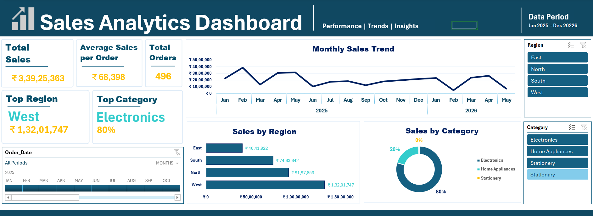

# Excel Business Analytics Project

## Objective
To solve real-world business problems using Microsoft Excel by applying data cleaning, reporting, financial analysis, and dashboarding techniques.

## Dataset
Corporate sales dataset including customer details, product information, transactions, and regional sales.

## Dashboard Preview
Interactive Sales Dashboard with KPIs, charts, slicers, and timelines.

## Project Components
1. **Customer Classification**  
   Classified customers into Platinum, Gold, Silver, and Blacklisted categories using a single formula.

2. **Customer Data Standardization**  
   Standardized names, created customer codes, and validated email addresses.

3. **Order & Delivery Analysis**  
   Calculated customer age, delivery time, and delivery status dynamically.

4. **Interactive Product Lookup System**  
   Built a lookup interface to retrieve product details instantly by Product ID.

5. **Sales Performance Summary Report**  
   Generated KPIs and metrics without pivot tables using formulas only.

6. **Sales Statistics Report**  
   Calculated average, median, standard deviation, and percentiles of sales.

7. **Product Performance Analysis**  
   Evaluated revenue, weighted average price, and discounts.

8. **Financial Analysis Report**  
   Estimated investment future value, required savings, and loan EMI.

9. **Data Validation & Cleaning**  
   Removed duplicates, handled missing values, standardized text, and applied validation rules.

10. **Interactive Sales Dashboard**  
    Designed a professional dashboard with KPI cards, charts, slicers, and timelines.

## Tools & Techniques
- Excel formulas (IF, VLOOKUP, SUMIFS, AVERAGE, MEDIAN, STDEV, PERCENTILE, FV, PMT)
- Data validation and conditional formatting
- Pivot Tables & Charts
- Dashboard design principles

## Key Insights
- Clear customer segmentation improves targeting.
- Delivery analysis highlights efficiency gaps.
- Product lookup system reduces manual effort.
- Financial modeling supports investment and loan decisions.
- Dashboard provides management with dynamic, real-time insights.

## Repository Structure
- `Corporate_Sales_Analysis.xlsx` → Full project file (all tasks + dashboard)
- `README.md` → Project overview
- `dashboard_screenshot.png` → Dashboard preview (optional)

## Outcome
A comprehensive Excel analytics project demonstrating how raw corporate data can be transformed into actionable insights, reports, and dashboards for business decision-making.

